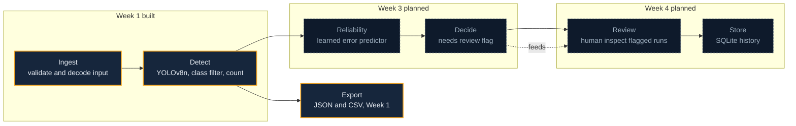

# Architecture

TrafficLens is organised as a six stage pipeline. The stages are ingest, detect,
reliability, decide, review, and store. Week 1 builds the first two and the export branch.
The later stages are scaffolded as honest placeholders so Week 2 to Week 4 extend them
without rewriting the foundation.

## Pipeline diagram

The same diagram is available as `docs/architecture.mmd` for tools that render Mermaid from
a file. Solid, amber nodes exist after Week 1. Dashed, muted nodes are planned.



## Stage by stage

| Stage | Status | Purpose | Where it lives |
| --- | --- | --- | --- |
| Ingest | Built | Validate the upload and decode it into an image array. | `core/validation.py` |
| Detect | Built | Run the detector, filter classes, apply the threshold, produce counts. | `core/detector.py`, `core/counting.py` |
| Reliability | Planned Week 3 | Predict how far the count can be trusted. | future `core/reliability.py` |
| Decide | Planned Week 4 | Turn a reliability score into a needs review flag. | future `core/reliability.py` |
| Review | Planned Week 4 | Let a human inspect flagged runs. | future `app/ui/reliability_tab.py` |
| Store | Planned Week 4 | Persist run history in SQLite. | future `core/history.py` |
| Export | Built | Serialise a run to JSON and CSV for download. | `core/export.py` |

## Module map

```text
core/
  config.py       target classes, thresholds, paths, colours
  validation.py   input checks and error types, decode to BGR
  detector.py     Detection dataclass, Detector protocol, YoloDetector
  counting.py     class filtering, per class counts, CountResult
  annotate.py     boxes and readable labels via supervision
  export.py       JSON payload, CSV row, export file names
app/
  main.py         sidebar, tabs, cached detector, limitations note
  ui/             one renderer per tab
```

## Design rules for Week 2 extension

* New detectors implement the `Detector` protocol and return `Detection` objects. Nothing
  downstream changes: `counting.count_vehicles` already accepts any detector.
* `CountResult` is the single contract between detection and every consumer, so the threshold
  sweep, sliced inference, and video tracking all return or extend it rather than inventing new
  shapes.
* The UI depends only on `core` functions and the `CountResult` fields, so adding a reliability
  score later means adding fields, not rewiring the tabs.
