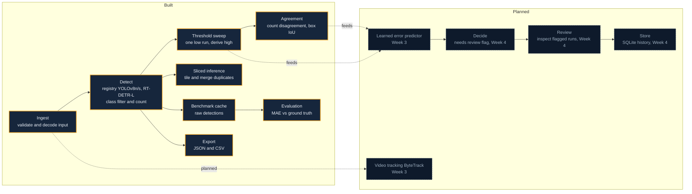

# Architecture

TrafficLens is organised as a six stage pipeline. The stages are ingest, detect,
reliability, decide, review, and store, with an evaluation branch that scores counts against
human ground truth. Week 1 built ingest, detect, and export. Week 2 extended detect to a
model registry and sliced inference, built the reliability agreement and threshold sweep with
their dashboard tab, and built the benchmark and ground-truth evaluation branch. The learned
error predictor, the needs review decision, and the SQLite store remain honest placeholders.

## Pipeline diagram

The same diagram is available as `docs/architecture.mmd` for tools that render Mermaid from
a file. Solid, amber nodes exist in the current codebase. Dashed, muted nodes are planned.



## Stage by stage

| Stage | Status | Purpose | Where it lives |
| --- | --- | --- | --- |
| Ingest | Built | Validate the upload and decode it into an image array. | `core/validation.py` |
| Detect | Built | Run any registry model, filter classes, apply the threshold, produce counts. | `core/detector.py`, `core/counting.py` |
| Sliced inference | Built | Run a detector on overlapping tiles and merge duplicates with class-aware NMS. | `core/detector.SlicedDetector` |
| Reliability (sweep and agreement) | Built | Sweep thresholds from one run and measure agreement between models. | `core/reliability.py`, `app/ui/reliability_tab.py` |
| Benchmark | Built | Cache raw detections per image, model, and mode for offline reuse. | `scripts/run_benchmark.py` |
| Evaluation | Built | Score cached counts against human ground truth, development subset excluded. | `core/evaluation.py`, `app/ui/evaluation_tab.py` |
| Learned error predictor | Planned Week 3 | Predict how far a count can be trusted from detection features. | future `core/reliability.py` |
| Video tracking | Planned Week 3 | Count distinct vehicles across a clip with ByteTrack. | future `core/video.py` |
| Decide | Planned Week 4 | Turn a reliability score into a needs review flag. | future `core/reliability.py` |
| Review | Planned Week 4 | Let a human inspect flagged runs. | future `app/ui/history_tab.py` |
| Store | Planned Week 4 | Persist run history in SQLite. | future `core/history.py` |
| Export | Built | Serialise a run to JSON and CSV for download. | `core/export.py` |

## Module map

```text
core/
  config.py       target classes, thresholds, sweep values, model registry, paths, colours
  validation.py   input checks and error types, decode to BGR
  detector.py     Detection dataclass, Detector protocol, Yolo and RT-DETR wrappers,
                  build_detector registry, SlicedDetector tiled wrapper
  counting.py     class filtering, per class counts, CountResult
  reliability.py  threshold sweep and the two H2 agreement measures
  evaluation.py   join labels, conditions, and the detection cache; MAE and bootstrap CIs
  annotate.py     boxes and readable labels via supervision
  export.py       JSON payload, CSV row, export file names
  dataset.py      archive parsing, ground truth mapping, tagging, test set selection
  curation.py     cleaning, condition tagging, and the seeded stratified test set build
app/
  main.py         sidebar (upload, classes, threshold, sliced toggle), tabs, cached detectors
  ui/             one renderer per tab; Image, Reliability, and Evaluation are live,
                  Video and History are labelled placeholders
scripts/
  clean_dataset.py     drop unreadable, unannotated, and near duplicate archive images
  tag_dataset.py       quartile condition cut offs, pinned before any sampling
  build_testset.py     seeded stratified draw, copies images, writes plan and artefacts
  check_testset.py     validate the test set folder before it is used
  run_detectors.py     per-image counts and timings for every registry model
  run_benchmark.py     cache raw detections per image, model, and mode
docs/
  metrics.md      every formula, so each reported number is reproducible
```

## Design rules

* New detectors implement the `Detector` protocol and return `Detection` objects. Nothing
  downstream changes: `counting.count_vehicles` already accepts any detector, and
  `SlicedDetector` wraps any detector without the callers knowing.
* `CountResult` is the contract between detection and every consumer, so the threshold
  sweep, sliced inference, and the evaluation join read or extend it rather than inventing
  new shapes.
* The agreement and range formulas are defined once in `core/reliability.py` and
  `core/evaluation.py` and documented in `docs/metrics.md`; the UI renders those values and
  never recomputes a metric inline.
* The dashboard tabs depend only on `core` functions, so the learned error predictor later
  adds fields to the Reliability tab rather than rewiring it.
