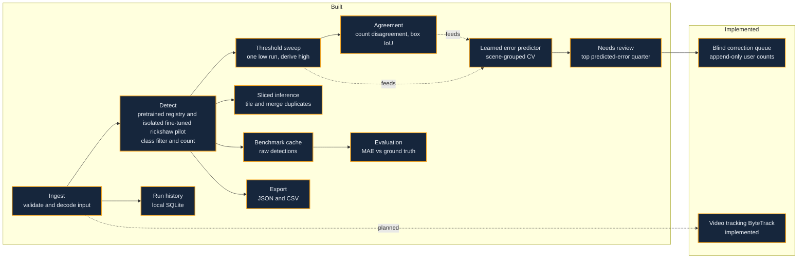

# Architecture

TrafficLens is organised as a six stage pipeline. The stages are ingest, detect,
reliability, decide, review, and store, with an evaluation branch that scores counts against
human ground truth. Week 1 built ingest, detect, and export. Week 2 extended detect to a
model registry and sliced inference, built the reliability agreement and threshold sweep with
their dashboard tab, and built the benchmark and ground-truth evaluation branch. The learned
error predictor and needs-review decision are now available as an offline, scene-grouped
evaluation workflow. The SQLite run-history store and blind, append-only user correction
loop are available.

## Pipeline diagram

The same diagram is available as `docs/architecture.mmd` for tools that render Mermaid from
a file. All solid nodes below are implemented. Implementation status does not imply that a feature has passed real-world evaluation.



## Stage by stage

| Stage | Status | Purpose | Where it lives |
| --- | --- | --- | --- |
| Ingest | Built | Validate the upload and decode it into an image array. | `core/validation.py` |
| Detect | Built | Run any registry model, filter classes, apply the threshold, produce counts. | `core/detector.py`, `core/counting.py` |
| Fine-tuned rickshaw mode | Pilot | Optional one-class detector in Image tab; does not enter pretrained reliability or baseline evaluation flows. | `core/config.py`, `core/finetuned.py`, `app/ui/image_tab.py` |
| Sliced inference | Built | Run a detector on overlapping tiles and merge duplicates with class-aware NMS. | `core/detector.SlicedDetector` |
| Reliability (sweep and agreement) | Built | Sweep thresholds from one run and measure agreement between models. | `core/reliability.py`, `app/ui/reliability_tab.py` |
| Benchmark | Built | Cache raw detections per image, model, and mode for offline reuse. | `scripts/run_benchmark.py` |
| Evaluation | Built | Score cached counts against human ground truth, development subset excluded. | `core/evaluation.py`, `app/ui/evaluation_tab.py` |
| History | Built | Deduplicated local SQLite image-run log with model results and reliability metadata. | `core/history.py`, `app/ui/history_tab.py` |
| Learned error predictor | Built; real-data validation gated | Predict audited absolute count error from inference-only features with scene-grouped cross-validation. | `core/predictor.py`, `scripts/run_predictor.py` |
| Video tracking | Built; not evaluated | Count line crossings across an uploaded clip with ByteTrack. | `core/video_counting.py`, `app/ui/video_tab.py` |
| Decide | Built | Flag the highest-predicted-error quarter for review and report scene-bootstrap metrics. | `core/predictor.py` |
| Review | Built | Blind, append-only user corrections with reveal and descriptive comparison. | `core/history.py`, `app/ui/history_tab.py` |
| Export | Built | Serialise a run to JSON and CSV for download. | `core/export.py` |

## Module map

```text
core/
  config.py       target classes, thresholds, sweep values, model registry, paths, colours
  validation.py   input checks and error types, decode to BGR
  detector.py     Detection dataclass, Detector protocol, Yolo and RT-DETR wrappers,
                  build_detector registry, SlicedDetector tiled wrapper
  finetuned.py    isolated rickshaw class mapping, contamination check, and split guards
  counting.py     class filtering, per class counts, CountResult
  reliability.py  threshold sweep and the two H2 agreement measures
  evaluation.py   join labels, conditions, and the detection cache; MAE and bootstrap CIs
  predictor.py    scene-grouped error prediction, bootstrap metrics, and review flags
  history.py      versioned local SQLite history, idempotent writes, and export queries
  annotate.py     boxes and readable labels via supervision
  export.py       JSON payload, CSV row, export file names
  dataset.py      archive parsing, ground truth mapping, tagging, test set selection
  curation.py     cleaning, condition tagging, and the seeded stratified test set build
app/
  main.py         sidebar (upload, classes, threshold, sliced toggle), tabs, cached detectors
  ui/             one renderer per tab; Image, Reliability, Evaluation, and History are live,
                  Video is implemented
scripts/
  clean_dataset.py     drop unreadable, unannotated, and near duplicate archive images
  tag_dataset.py       quartile condition cut offs, pinned before any sampling
  build_testset.py     seeded stratified draw, copies images, writes plan and artefacts
  check_testset.py     validate the test set folder before it is used
  run_detectors.py     per-image counts and timings for every registry model
  run_benchmark.py     cache raw detections per image, model, and mode
  run_finetuned_evaluation.py separate fine-tuned cache/evaluation; preserves pretrained entries
  run_predictor.py     evaluate error prediction after audited-label readiness checks
docs/
  metrics.md      every formula, so each reported number is reproducible
```

## Design rules

* New detectors implement the `Detector` protocol and return `Detection` objects. Nothing
  downstream changes: `counting.count_vehicles` already accepts any detector, and
  `SlicedDetector` wraps any detector without the callers knowing.
* `CountResult` is the contract between detection and every consumer, so the threshold
  sweep, sliced inference, and the evaluation join read or extend it rather than inventing
  new shapes.
* The agreement and range formulas are defined once in `core/reliability.py` and
  `core/evaluation.py` and documented in `docs/metrics.md`; the UI renders those values and
  never recomputes a metric inline.
* The offline predictor and its review flags live in `core/predictor.py`; a future dashboard
  integration can render these results without reimplementing model or metric logic.
