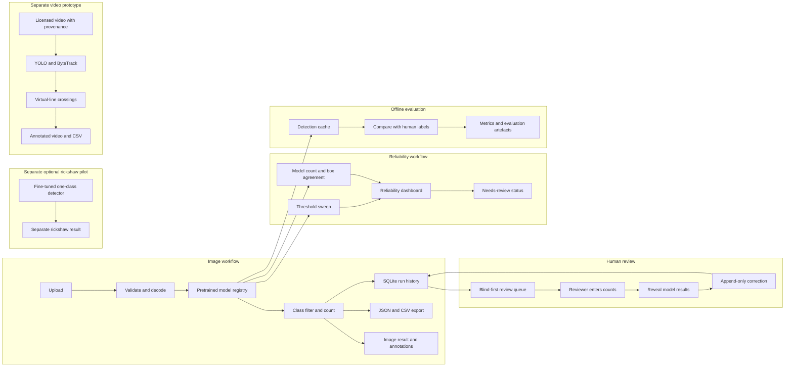

# Architecture

TrafficLens is a Streamlit application for vehicle counting in single road-scene images,
with a separate video-crossing prototype. Its main image path is ingest, detect, count,
display/export, and local history. A separate Reliability tab compares pretrained model
outputs; Evaluation compares cached model outputs with human reference labels. Human review
is a separate, blind-first, append-only correction workflow.

All results are a pilot on Dhaka imagery. Reference counts are human counts; the documented
pass-consistency estimate is a mean absolute difference of 1.62 vehicles (95% scene-bootstrap
interval 0.67–2.46; 13 paired images across 7 scenes). The optional fine-tuned rickshaw mode
is a separate one-class model with its own evaluation and contamination exclusions. It does
not replace pretrained multi-class counts or enter their reliability comparisons.

## System diagram



## Components and status

| Component | Status | Responsibility | Main implementation |
| --- | --- | --- | --- |
| Image ingest | Built | Validate extension/size and decode image bytes to BGR. | `core/validation.py` |
| Pretrained detection | Built | Load registry detectors and produce class-labelled boxes. | `core/detector.py` |
| Counting and annotation | Built | Filter selected classes, aggregate counts, draw boxes. | `core/counting.py`, `core/annotate.py` |
| Sliced inference | Built | Run overlapping image tiles and merge detections. | `core/detector.py` |
| Reliability | Built | Compare model counts and box overlap; derive count ranges. | `core/reliability.py` |
| Error prediction / review flag | Experimental, validation-gated | Offline predictor workflow exists; the user-facing flag must remain explicitly not validated unless the required evidence/configuration is available. | `core/predictor.py`, `core/reliability_prediction.py` |
| Evaluation | Built | Compare cached detections with human labels and report descriptive pilot metrics. | `core/evaluation.py`, `app/ui/evaluation_tab.py` |
| Fine-tuned rickshaw mode | Optional pilot | Separate one-class rickshaw inference and separate contamination-aware evaluation. | `core/finetuned.py`, `app/ui/image_tab.py` |
| Run history | Built | Deduplicated local SQLite record of image runs and metadata; image bytes are not stored. | `core/history.py` |
| Human review | Built | Blind-first queue, exact-image hash check, reveal step, append-only user corrections. | `app/ui/history_tab.py` |
| Video crossings | Prototype; not evaluated | Provenance-gated upload, local pretrained detector, ByteTrack, directed virtual line, annotated video and CSV. | `core/video_counting.py`, `app/ui/video_tab.py` |

## Data and evidence boundaries

- The Reliability tab measures disagreement between models. It does not establish which model
  is correct.
- The Evaluation tab uses human reference counts. Human labels and their pass consistency
  must be interpreted within the small Dhaka pilot and its scene coverage.
- H1 and H2 are **not tested** under the project's current pre-registered evidence rules.
  H3 and H4 are **descriptive only**.
- The optional fine-tuned detector has training/test overlap exclusions and a separate
  evaluation. Its source-data licence and citation remain unresolved in the project notes.
- Video output has not been evaluated against annotated video ground truth and carries no
  accuracy claim.
- Review corrections are user-reported. They are not written to LABELS.csv and do not update
  model weights, inference settings, or evaluation results.

## Module map

```text
app/main.py              Streamlit shell, sidebar, cached detector resources
app/ui/image_tab.py      image upload, count, zone analysis, optional fine-tuned mode
app/ui/reliability_tab.py model comparison, agreement, review status
app/ui/evaluation_tab.py human-reference evaluation artefacts
app/ui/history_tab.py    local history, blind review, corrections and exports
app/ui/video_tab.py      provenance-gated video crossing prototype
core/validation.py       image input validation and decode
core/detector.py         detector protocol, registry wrappers, sliced inference
core/counting.py         class filtering and count result
core/reliability.py      threshold sweep and agreement metrics
core/evaluation.py       label join, error metrics and intervals
core/predictor.py        experimental error prediction workflow
core/history.py          SQLite schema, migrations, run/correction operations
core/video_counting.py   frame detection, tracking and virtual-line crossings
scripts/                 dataset curation, benchmark, evaluation and analysis workflows
```
