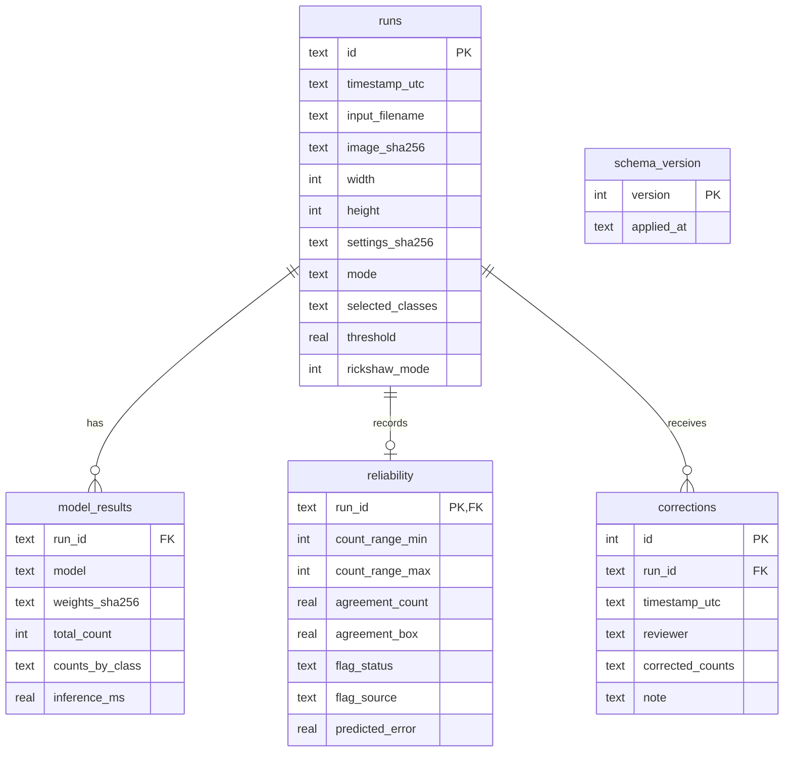

# Local run history database

TrafficLens stores local image-run metadata in `data/history.db`. SQLite foreign keys
are enabled for every connection. Uploaded image bytes are never stored. Original
filenames are retained so a user can recognize a run; this is stated in the History
tab. Results are a pilot on Dhaka imagery. The current human pass-consistency summary
is a mean absolute total-count difference of 1.62 vehicles over 13 paired images in 7
scenes (95% scene-bootstrap interval 0.67 to 2.46 vehicles). The optional fine-tuned
detector has a separate pilot evaluation; 49 of 75 test images overlap training data and
are excluded from its evaluation. The database is gitignored, including its write-ahead
log files.

The schema is managed by `core.history.migrate`. The migration version is stored in
`schema_version`; migrations are applied in ascending order. If the file is corrupt,
locked, or unwritable, the UI reports that history is unavailable while leaving image
counting available.



An idempotency constraint prevents repeated Streamlit reruns from duplicating a run
with the same image hash, settings hash, classes, threshold, mode, and rickshaw-mode
state. Indexes support image-hash and timestamp lookups.

## Example queries

List recent runs:

```sql
SELECT id, timestamp_utc, input_filename, mode, rickshaw_mode
FROM runs
ORDER BY timestamp_utc DESC
LIMIT 50;
```

Summarize model counts for a run:

```sql
SELECT model, total_count, counts_by_class, inference_ms
FROM model_results
WHERE run_id = :run_id
ORDER BY model;
```

List runs with their latest correction:

```sql
SELECT r.id, r.input_filename, c.reviewer, c.timestamp_utc, c.corrected_counts
FROM runs AS r
JOIN corrections AS c ON c.run_id = r.id
WHERE c.id = (
    SELECT MAX(c2.id) FROM corrections AS c2 WHERE c2.run_id = r.id
);
```

History is machine-local and is not ground truth. Human corrections, when added, are
user-reported review data and are not written to `LABELS.csv`.
